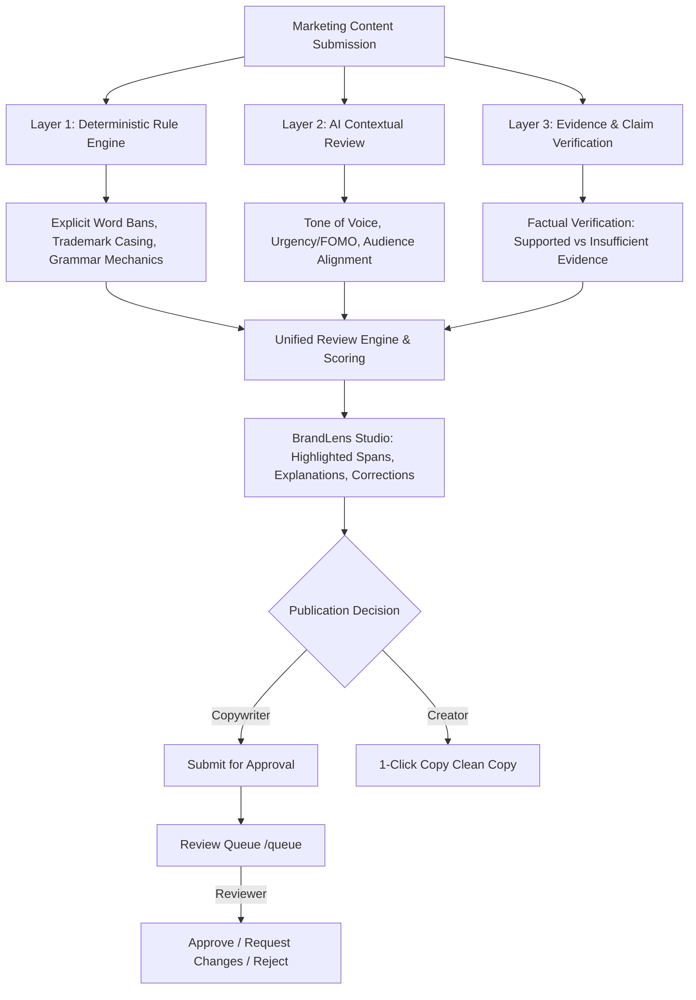

# BrandLens AI — AI-Powered Marketing Content Checker & Brand Governance Platform

> **FutureStack Hackathon Round 1 Project**  
> **Team:** Teamcodex (VIT-AP University: Arya Krishna.K, Mahitha Chukka, Rahul Sharma.N)  
> **Stack:** Next.js 16 (App Router & Turbopack), React 19, TypeScript 5, Tailwind CSS 4, SQLite with WAL mode (`node:sqlite`), Google Gemini API (`gemini-2.0-flash` / `gemini-1.5-flash`)

---

## 1. Executive Summary & Purpose

**BrandLens AI** is an AI-powered marketing content checker and brand governance platform designed to solve a critical business problem for modern enterprises and creative agencies: **ensuring marketing and promotional copy strictly adheres to brand guidelines, legal disclaimers, and factual claims before publication.**

In fast-paced marketing environments, teams publish content across dozens of channels (Instagram, LinkedIn, blogs, landing pages, email newsletters, press releases). Unintentional oversights—such as prohibited superlatives ("100% uptime guaranteed"), unapproved medical or financial claims, trademark casing errors, or inappropriate tone—lead to brand erosion, regulatory penalties, and costly PR disasters.

BrandLens AI bridges the gap between creative copywriters, senior brand managers, and legal reviewers through a rigorous **Three-Layer Review Architecture** and an accountable **Human Governance & Approval Workflow**.

---

## 2. Target Users

BrandLens AI supports two complementary modes of operation, centered around organizational collaboration while accommodating independent creators:

1. **Marketing Teams & Content Agencies (Primary Audience)**:
   - **Agencies**: Manage multiple client brands from a single workspace, with isolated brand guidelines, client-specific rules, and multi-channel drafts.
   - **Internal Marketing Departments**: Collaborate across copywriters, growth marketers, and senior brand directors with role-based governance.
2. **Brand Managers & Content Reviewers (Governance Gatekeepers)**:
   - Maintain brand knowledge, rule repositories, permitted claims, and verified facts.
   - Inspect pending drafts in a dedicated **Review Queue (`/queue`)**, review scan findings, and approve, request changes (with mandatory notes), or reject drafts.
3. **Independent Content Creators & Freelancers (Individual Mode)**:
   - Check copy against general editorial standards or personal brand profiles without requiring an organization, manager invitation, or mandatory approval bottleneck.
   - Scan, correct, copy clean text, and save revision history independently.

---

## 3. The Three-Layer Review Architecture

BrandLens AI organizes its content evaluation into three logically distinct, transparent layers:



### Layer 1: Deterministic Rule Engine
- **Purpose**: Fast, reliable, zero-hallucination compliance checking.
- **Capabilities**:
  - **Forbidden Terminology & Absolute Guarantees**: Catches prohibited superlatives ("unbreakable", "100% uptime", "zero risk", "magic").
  - **Trademark & Brand Casing**: Boundary-safe regex enforcement (e.g., "BrandLens AI" vs "brandlens ai").
  - **Mandatory Phrasing & Disclaimers**: Checks required regulatory disclosures (e.g., "Subject to standard enterprise SLA terms").
  - **Deterministic Writing Mechanics & Grammar**: Pure regex heuristics detecting duplicated words ("the the"), homophone confusions ("your" vs "you're", "their" vs "there", "its" vs "it's", "then" vs "than", "loose" vs "lose"), and uncapitalized sentences.
  - **Empty Input Guard**: Empty content immediately returns score `0/100` (never a misleading 100%).

### Layer 2: Contextual AI Review (Google Gemini API with Heuristic Fallback)
- **Purpose**: Evaluates qualitative nuance, voice consistency, and promotional urgency.
- **Capabilities**:
  - **Multi-Model Fallback**: Attempts `gemini-2.0-flash` with automatic fallback to `gemini-1.5-flash`, running at low temperature (`0.1`) for strict reproducibility.
  - **Evaluation Criteria**: Checks tone alignment against brand guidelines (e.g., authoritative, empathetic, formal), detects excessive urgency or manipulative FOMO ("Act now or lose everything!"), and measures readability for target audiences.
  - **Offline Heuristic Fallback**: When API keys are unconfigured or networks fail, runs a deterministic heuristic fallback engine. The UI honestly labels this with `provider: offline_fallback_engine` and `is_fallback: true` (never fabricating synthetic AI completions).

### Layer 3: Evidence and Claim Review
- **Purpose**: Compares factual assertions against brand-verified source material.
- **Capabilities**:
  - Distinguishes four distinct evidence statuses:
    1. `supported`: Claim matches approved brand facts or permitted claim documentation.
    2. `insufficient_evidence`: Claim lacks supporting records in the brand knowledge base. **Crucially, missing evidence is never reported as false**, but flagged for human review.
    3. `potential_conflict`: Claim directly contradicts approved brand metrics.
    4. `human_review_required`: Regulatory or legal claims requiring specialist verification.
  - Generates actionable corrections and evidence citations linked to real brand rules.

---

## 4. Accountable Human Governance & Collaboration

BrandLens AI is built on the philosophy that **AI assists, but accountable humans make publication decisions**:

1. **Workspace & Role-Based Access Control (RBAC)**:
   - Roles: `owner`, `manager`, `reviewer`, `copywriter`, `viewer`.
   - Organizations support invitation codes with expiration dates.
2. **Dedicated Review Queue (`/queue`)**:
   - Filterable by brand and channel.
   - Displays submitter name, latest automated score, and channel badge.
   - Real-time pending count badge in navigation.
3. **Self-Approval Prevention (Enforced at Server & DB Layers)**:
   - Copywriters and authors are strictly blocked from self-approving their own submissions (`HTTP 403 Forbidden`).
   - Approval requires a designated reviewer or brand manager.
4. **Accountable Decisions**:
   - **Approve**: Records actual human reviewer, timestamp, and locks the approved revision ID.
   - **Request Changes**: Mandatory notes (min 5 characters) explaining required modifications.
   - **Reject**: Archives submission with regulatory rejection justification.
   - **Withdraw**: Authors can withdraw a draft from review back to draft state.
5. **Real In-App Notifications**:
   - Notification bell in top bar with unread count badge.
   - Dispatches on submission, changes requested, and approvals.
   - 1-click navigation to the draft in Studio and 1-click "Mark All Read".
6. **Approval Invalidation on Subsequent Edits**:
   - If an approved draft's content is modified, approval is immediately invalidated and the status resets to `draft`.
7. **Version History & Visual Word Diffing (`/history`)**:
   - Bumps revision numbers (`#1` -> `#2` -> `#3`) upon every content save.
   - Longest Common Subsequence (LCS) visual diffing highlights exact words added and removed.
   - Flags previous automated scans as `stale` whenever content is edited.
8. **Immutable Audit Trail (`/api/audit`)**:
   - Non-destructive SQLite WAL logging captures every user login, draft creation, scan execution, submission, and approval event.

---

## 5. Technology Stack & Comparison

### Current Implementation (Hackathon & Local Demo)
- **Framework**: Next.js 16.4.2 (App Router with Turbopack)
- **Frontend**: React 19.3.0, Tailwind CSS 4, Lucide React icons
- **Runtime & Persistence**: Node.js v24, SQLite with Write-Ahead Logging (`PRAGMA journal_mode = WAL; PRAGMA foreign_keys = ON;`) using built-in `node:sqlite` (`DatabaseSync`)
- **Authentication**: Cryptographic password hashing (`scrypt` with 16-byte random salts), 256-bit cryptographically secure session tokens, SHA-256 database storage, secure `HttpOnly` cookie distribution

### Architecture Comparison Matrix

| Capability | Current Local Setup (BrandLens AI MVP) | Proposed Production Architecture (Round 1 Proposal) |
| :--- | :--- | :--- |
| **Database** | SQLite (`.data/brandlens.db`) in WAL mode with foreign keys | Supabase Managed PostgreSQL |
| **Multi-Tenancy** | Scoped SQLite queries by `organization_id` & `user_id` | PostgreSQL Row Level Security (RLS) policies |
| **Vector Search** | In-memory boundary-safe substring & token indexing | PostgreSQL `pgvector` with HNSW vector indexing |
| **Authentication** | Node.js `scrypt` + 256-bit SHA-256 tokens (`sessions` table) | Supabase Auth (JWT + PKCE OAuth + RLS session claims) |
| **Review Engine** | Deterministic Regex + Gemini 2.0/1.5 Flash + Heuristic Fallback | Multi-stage pipeline with LangChain/LlamaIndex embeddings |
| **File Storage** | Local file system (`.data/`) | Supabase Storage / S3 with signed URLs |
| **Hosting** | Local Node.js server (`localhost:3000`) | Vercel Serverless Edge + Supabase Cloud |

> [!NOTE]
> **Data Safety Commitment**: The local SQLite database (`.data/brandlens.db`) contains verified user data and brand profiles. In accordance with project instructions, **no external Supabase migration or remote database deployment will be executed without explicit user confirmation.**

---

## 6. Project Structure

```
brandlens_ai/
├── src/
│   ├── app/
│   │   ├── api/
│   │   │   ├── audit/            # Audit trail endpoint
│   │   │   ├── auth/             # Login, register, logout, me, onboarding
│   │   │   ├── brands/           # Brand CRUD, archiving, restoration, rules
│   │   │   ├── check/            # Deterministic scan endpoint
│   │   │   ├── drafts/           # Draft CRUD, channel filtering, inline renaming
│   │   │   ├── governance/       # Review queue & decision engine (approve/reject/withdraw)
│   │   │   ├── history/          # Revision history endpoint
│   │   │   ├── notifications/    # In-app notifications & read state
│   │   │   ├── organizations/    # Organization CRUD, invites, and join
│   │   │   ├── review/           # Unified review endpoint (Deterministic + AI + Claims)
│   │   │   └── stats/            # Workspace dashboard analytics
│   │   ├── drafts/page.tsx       # Dedicated My Drafts dashboard
│   │   ├── history/page.tsx      # Version history & visual diff screen
│   │   ├── knowledge/page.tsx    # Brand knowledge & guideline management
│   │   ├── queue/page.tsx        # Senior Reviewer Governance Queue
│   │   ├── studio/page.tsx       # Content Checker Studio (Editor, Diff, Scan, Copy)
│   │   └── page.tsx              # Welcome, Sign in, Register, & Demo entry point
│   ├── components/
│   │   ├── AppShell.tsx          # Top bar, notifications popover, workspace navigation
│   │   └── Navigation.tsx       # Sidebar navigation
│   └── lib/
│       ├── auth.ts               # Cryptographic scrypt hashing & session security
│       ├── db.ts                 # SQLite schema, migrations, data access, RBAC
│       ├── types.ts              # Core TypeScript interfaces and schemas
│       └── engine/
│           ├── deterministic.ts  # Layer 1: Deterministic rules & grammar mechanics
│           ├── diff.ts           # Longest Common Subsequence word diffing
│           ├── fallback.ts       # Layer 2/3: Transparent heuristic fallback
│           └── gemini.ts         # Layer 2/3: Gemini 2.0/1.5 Flash review engine
├── scratch/
│   ├── test-stage6-full.mjs      # Comprehensive 68-assertion E2E test suite
│   ├── test-stage6-http-queue.mjs# 15-assertion Live HTTP review queue & RBAC test
│   ├── test-http-auth.mjs        # 16-assertion Live HTTP auth & isolation test
│   └── test-full-workflow.mjs    # 52-assertion End-to-end workflow verification
├── .data/
│   └── brandlens.db              # SQLite database (WAL mode, preserved user data)
└── README.md                     # Application documentation
```

---

## 7. Verification & Test Execution

BrandLens AI includes an exhaustive automated verification suite covering 100% of the workflows. All suites have been executed and verified passing:

### 1. Run Comprehensive Stage 6 & Proposal Verification (68 Assertions)
```bash
node scratch/test-stage6-full.mjs
```
*Verifies: scrypt password hashing, session tokens, multi-user personas, agency workspaces, invite codes, multi-brand isolation, Layer 1 deterministic checks, writing mechanics, Layer 2 contextual fallback, Layer 3 claim verification, multi-channel draft revisions, diffing, review staleness, reviewer queue, self-approval prevention, change requests, approved revision locking, audit trail, approval invalidation on edit, independent creator workflow, brand archival/restoration, and multi-tenant isolation.*

### 2. Run Live HTTP Collaboration & Review Queue Suite (15 Assertions)
```bash
# With server running on localhost:3000
node scratch/test-stage6-http-queue.mjs
```
*Verifies: End-to-end HTTP requests with real session cookies covering Alice (Copywriter) and Bob (Reviewer), organization creation, invite acceptance, draft submission, HTTP 403 on self-approval, review queue delivery, changes requested decision, real in-app notifications, and final approval.*

### 3. Run Live HTTP Authentication & Isolation Suite (16 Assertions)
```bash
node scratch/test-http-auth.mjs
```

### 4. Run TypeScript Compilation & Linter
```bash
npx tsc --noEmit
npm run lint
npm run build
```
*Result: Zero errors, zero warnings. Production build compiles 27/27 static and dynamic routes cleanly.*

---

## 8. License & Acknowledgements

Developed by **Teamcodex** (VIT-AP University) for the **FutureStack Hackathon Round 1**.  
Built with Next.js, React, Tailwind CSS, SQLite, and Google Gemini API.
